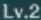

# Genshin image script

[test_teleport.py](test_teleport.py) uses the ordinary SwifTest API and the six PNGs
shown below. It needs no `ui.json`, OCR engine, custom profile or benchmark runner.

```python
from swiftest import Position, Template, open_app, touch


def test_teleport():
    ready = Template("assets/level.png", threshold=.8, region=(.36, .87, .45, .97))
    open_app("com.miHoYo.GenshinImpact",
             through=[Template("assets/entry.png", threshold=.75), "assets/door.png"],
             expect=ready)
    touch(Position(.085, .145), expect="assets/map.png")
    touch(Position(.499, .498), expect="assets/waypoint_title.png")
    touch("assets/teleport.png", expect=ready)
```

The script contains four game operations and one reusable ready-screen selector.
`through` lists entry buttons in progression order. The runtime recognizes the
current screen, skips earlier entry steps, and taps each remaining button at most
once. It accepts an already-ready game immediately. The three touches open the
map, select the waypoint and teleport, with their expected results.
There are no script sleeps, polling loops, state branches or retry counters.
The runner owns capture, matching, polling, input checks and reports.

## Run

```text
python -m pip install .
swiftest run examples/genshin/test_teleport.py --serial YOUR_DEVICE_SERIAL --timeout 240
```

The runner timeout is an execution limit; it is not a fixed delay. Choose it for
your test environment without adding waits to the game script.

This example records **Traditional Chinese at 2400 × 1080 in landscape**.
The game must already be signed in, with downloads complete and the recorded
waypoint unlocked at the map center. The two `Position` values identify the
minimap and that waypoint. Update these for your account/map position; this is
not a destination search. Keep the device awake with touch protection dismissed.
Unrecognized login, download and other dialogs time out without an automatic response.

The images use their original pixel size. The animated Start Game prompt keeps
the original benchmark's 0.75 threshold. The small level marker keeps its 0.80
threshold and bounded HUD region. The other images use the default 0.90. For
another language, theme or resolution, replace the relevant crops or use
`Template("assets/teleport.png", region=(...), scale_range=(...))` with tested
options. Filename shortcuts do not infer translations or resizing.

## Included template images

| File | Image | Used for |
| --- | --- | --- |
| [entry.png](assets/entry.png) |  | First startup prompt |
| [door.png](assets/door.png) |  | Second startup prompt |
| [level.png](assets/level.png) |  | Gameplay HUD |
| [map.png](assets/map.png) |  | Map is open |
| [waypoint_title.png](assets/waypoint_title.png) |  | Waypoint panel is open |
| [teleport.png](assets/teleport.png) |  | Button to tap |

`teleport.png` contains the complete button: its short label also occurs in the
panel title, so matching the label alone finds two targets. SwifTest refuses
ambiguous input rather than choosing one. The six crops contain no account ID;
their source dimensions, crop bounds and hashes are in
[provenance.json](assets/provenance.json). Game artwork belongs to its respective
owners. These are example test inputs, not general-purpose UI artwork.

The earlier standalone import omitted all screenshot-derived assets. Its starter
used native Android nodes and its Genshin profile used OCR, so neither needed
PNGs. This image example supplies its own crops in Git and in source packages.
Full captures, recordings and experiment output remain excluded.

## Scope and verification

Offline tests run this exact script through the normal runner with the shipped
PNGs, exercising both startup prompts, entry midway through startup and an
already running game. They verify input order, no repeated startup/teleport tap,
loading followed by HUD return, and no OCR or hierarchy reads.

On November 9, the simplified script also passed two live checks on the previously
used Samsung SM-G781B: entry-to-gameplay issued five taps, and an already-running
game issued three. Both verified the returning HUD, with zero OCR and hierarchy
reads; the first arrival screenshot was visually checked. The tests used explicit
PNG capture and a 120-second runner deadline. They verify this layout's behavior,
not a latency or energy improvement. The phone was returned to its prior Settings
screen. Raw reports and captures remain in ignored local storage.

The earlier version of this example passed replay against all four November 7 Airtest recording
sequences (`01`, `04`, `06`, `07`), with five inputs each. These are recorded-screen
checks, not new device runs. Initial use of 0.90 everywhere missed the Start Game
prompt in three sequences and the level marker in two. Restoring those two
selectors' existing benchmark settings resolved the misses. The recordings stay
in ignored local artifact storage; no new speed or device-portability result is claimed.

This is an authoring example, not a replacement for the historical performance
experiment. It checks the waypoint panel and returning HUD; it does not measure
loading transitions, prove a different destination, or recover Samsung overlays.
The [benchmark guide](../../docs/android-genshin-benchmark-usage.md) retains the
original OCR profile and independently instrumented Airtest comparison.
